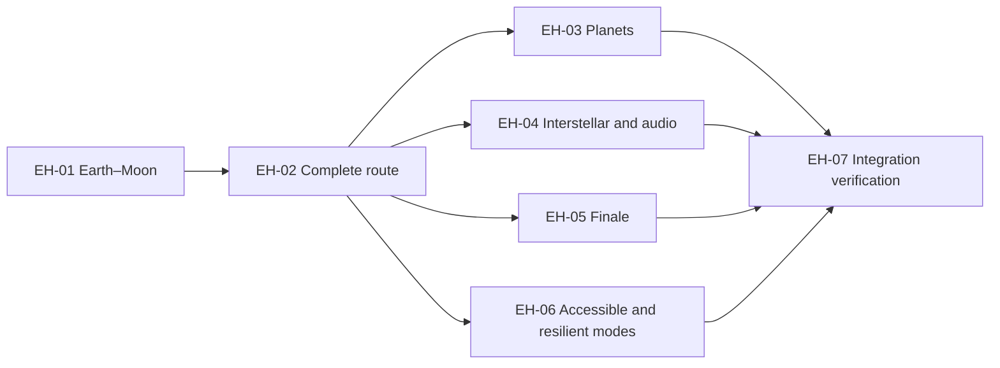

# Immersive journey implementation tickets

The user approved this seven-ticket breakdown and dependency graph. The configured tracker is local Markdown; no remote issues are created.

[EH-SPEC: approved implementation specification](spec.md) is the shared product contract. Its requirements match the original project specification; publication metadata reflects the completed tracker setup. Each ticket supplies its own context, acceptance criteria, verification steps and scope boundary.

## Dependency order

| ID    | Ticket                                                                                                                | Blocked by                 | Status          |
| ----- | --------------------------------------------------------------------------------------------------------------------- | -------------------------- | --------------- |
| EH-01 | [Interactive Earth–Moon flight with live telemetry](issues/01-earth-moon-flight.md)                                   | None                       | resolved        |
| EH-02 | [Complete 13-stop route, scientific model, and navigation](issues/02-complete-route-navigation.md)                    | EH-01                      | resolved        |
| EH-03 | [Photorealistic planetary encounters from Earth through Neptune](issues/03-photorealistic-planets.md)                 | EH-02                      | resolved        |
| EH-04 | [Voyager and Proxima encounters with immersive interstellar travel and audio](issues/04-interstellar-travel-audio.md) | EH-02                      | resolved        |
| EH-05 | [Sagittarius A* observation, explicit descent, and replay](issues/05-black-hole-finale.md)                            | EH-02                      | resolved        |
| EH-06 | [Accessible motion modes and resilient journey playback](issues/06-accessible-resilient-journey.md)                   | EH-02                      | resolved        |
| EH-07 | [Integrate and verify the complete immersive journey](issues/07-full-journey-verification.md)                         | EH-03, EH-04, EH-05, EH-06 | ready-for-agent |

## Execution

EH-01 (`66f08cb`), EH-02 (`20ef706`), EH-03 (evidence: [docs/verification/eh-03.md](../../docs/verification/eh-03.md)), EH-04 (evidence: [docs/verification/eh-04.md](../../docs/verification/eh-04.md)), EH-05 (evidence: [docs/verification/eh-05.md](../../docs/verification/eh-05.md)), and EH-06 (evidence: [docs/verification/eh-06.md](../../docs/verification/eh-06.md)) are resolved. EH-02's acceptance evidence is in [docs/verification/eh-02.md](../../docs/verification/eh-02.md). The next unblocked ready-for-agent ticket is **EH-07**. A ready-for-agent ticket may start only when every listed blocker is resolved; ticket files are authoritative if this summary becomes stale.

Each implementation ticket must land with its relevant checks and a working demo. EH-07 adds integrated acceptance, rather than carrying all testing. EH-01 uses an additive controller/temporary adapter to keep later existing destinations functional until EH-02 migrates the complete route. No separate infrastructure-only prefactoring ticket is needed.

## Specification coverage

| Specification area                                                                   | Primary owner                                      | Integration evidence                       |
| ------------------------------------------------------------------------------------ | -------------------------------------------------- | ------------------------------------------ |
| Controller, phases, timing envelope, inspection-to-departure continuity              | EH-01                                              | EH-02 all legs; EH-07                      |
| Wheel thresholds, inertia rejection, drag/zoom, touch and keyboard basics            | EH-01                                              | EH-06 accessibility; EH-07                 |
| Live mph/×c, digit rolling, Earth displacement and pause semantics                   | EH-01                                              | EH-02 galactic scale; EH-07                |
| 13 stops, 236 seconds, direct/reverse/history navigation and legacy URLs             | EH-02                                              | EH-07                                      |
| Scientific route, black-hole parameters, reference snapshot and source migration     | EH-02                                              | EH-05 horizon view; EH-07                  |
| Three facts, Details/Sources, consistent rest/transit UI and expandable rail         | EH-01, EH-02                                       | EH-03–EH-06 visual/content updates; EH-07  |
| Earth through Neptune materials, Sun, rings, asset provenance and local choreography | EH-03                                              | EH-07                                      |
| Voyager/Proxima assets, long-flight scenery and optional sound                       | EH-04                                              | EH-07                                      |
| Black-hole handoff, observation, explicit descent, interior and replay               | EH-05                                              | EH-07                                      |
| Reduced motion, focus/announcements, loading timeout, fallback and context loss      | EH-06                                              | EH-07 covers later final-scene adapters    |
| Adjacent preloading, disposal and adaptive-quality lifecycle                         | EH-03/EH-04 asset integration; EH-06 shared policy | EH-07 repeated-traversal/hardware evidence |
| All numerical/browser/visual checks, documentation and honest hardware limitations   | Each ticket locally                                | EH-07 final evidence report                |

User stories 1–31 are all assigned in ticket bodies. Shared concerns are integration obligations, not duplicate implementations. All work remains within the specification's exclusions: no deployment, push, new itinerary, cockpit, ground-level mapping or unrelated product expansion.
