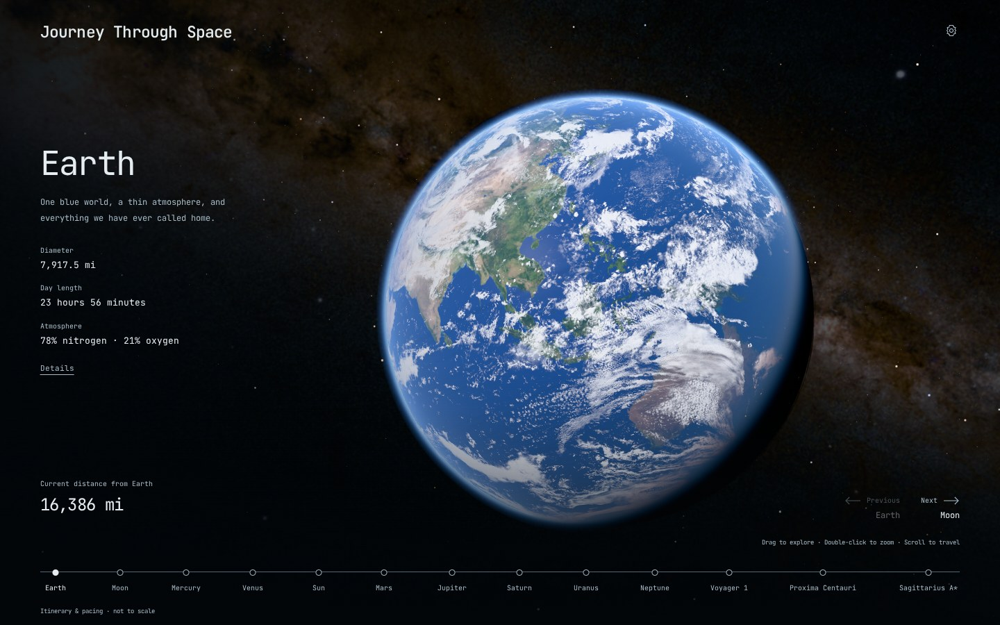

# Journey Through Space

An interactive journey from Earth to Sagittarius A*, with 13 observation stops along the way. Inspect worlds up close, take timed flights between destinations, or jump straight to a stop on the route.

[Open Journey Through Space](https://journey-through-space.ericzwierzynski.dev)



## How it works

Three.js renders the worlds and flights using bundled textures. Use **Next** and **Previous** to fly between stops, or select a destination on the bottom route to jump there. You can pause or skip a flight and switch units, motion, and sound in Settings. The science model uses approximate distances and positions, with illustrative framing and compressed flight times.

## Run locally

Use Node.js 22.18 or later. Node.js 24 is recommended.

```sh
npm ci
npm run dev
```

Open the URL printed by Vite, usually [localhost:5174](http://localhost:5174). Use `npm run build` for a production build.

[Science, controls, and rendering notes](docs/technical-reference.md) · [Deployment](docs/DEPLOYMENT.md)
